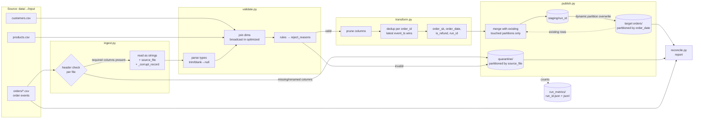

# Architecture and data flow



ASCII version:

```
 orders/*.csv ─► [ingest] header check ──missing cols──────────────────────┐
                    │ read as strings (+source_file, +_corrupt_record)      │
 customers.csv ─┐   ▼                                                       ▼
 products.csv ──┴► [validate] parse → join dims → rules ──invalid──► quarantine/ (by source_file)
                    │ valid
                    ▼
                 [transform] prune → dedup(order_id, latest event_ts) → derive cols
                    │
                    ▼
                 [publish] read existing rows of touched order_date partitions
                           merge by order_id ─► staging/<run_id> ─► target orders/ (by order_date)
                    │
                    ▼
                 run_metrics/<run_id>.json, run_metrics.jsonl   ─►  [reconcile] report
```

## Module responsibilities

| Module | Responsibility |
|---|---|
| `config.py` | `PipelineConfig` dataclass, JSON config + CLI overrides |
| `spark_session.py` | SparkSession (UTC, strict date parser, dynamic overwrite), baseline/optimized confs |
| `schemas.py` | all column contracts (raw, dims, target, quarantine) |
| `ingest.py` | list files, per-file schema check, string read, lineage columns |
| `validate.py` | parsing, rule evaluation, referential integrity, reject projection |
| `transform.py` | column pruning, dedup (window vs group-by), target shaping |
| `publish.py` | merge-by-key, staging + swap, quarantine write, failure hook |
| `metrics.py` | `RunMetrics`, atomic JSON write, JSONL history |
| `pipeline.py` | orchestration + CLI, exit codes |
| `benchmark.py` | baseline vs optimized timing and shuffle metrics → `performance_report.md` |
| `reconcile.py` | independent source vs target checks → `reconciliation_report.md` |
| `data_generator.py` | reproducible test data + expected-outcome labels |
